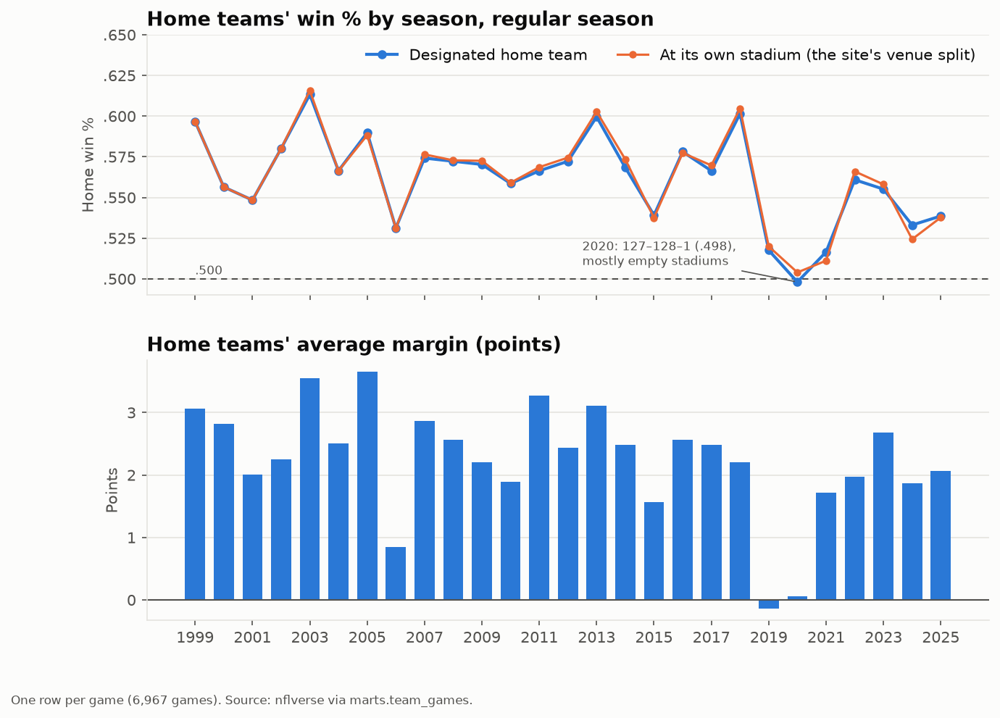
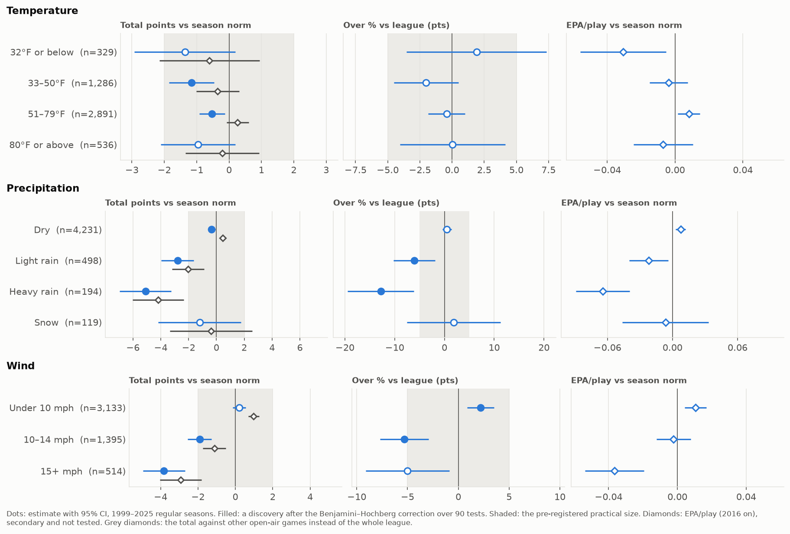
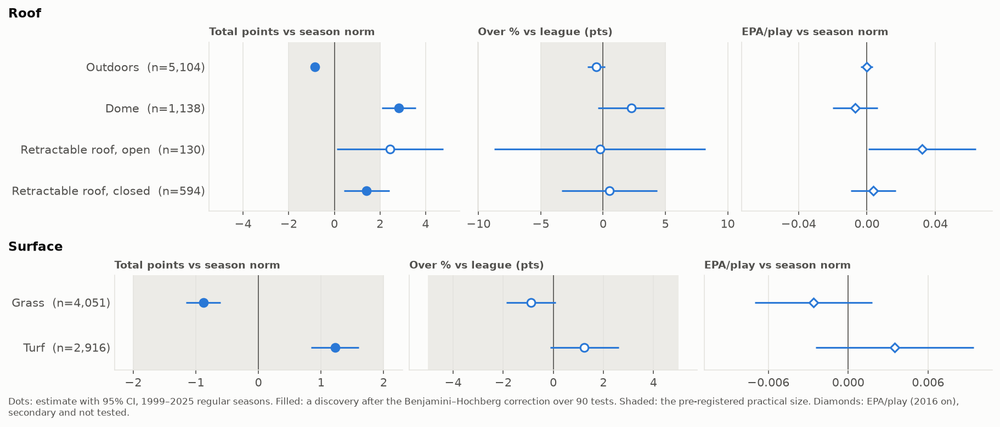
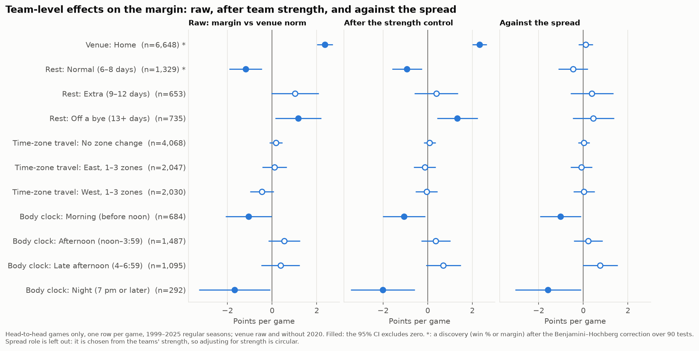
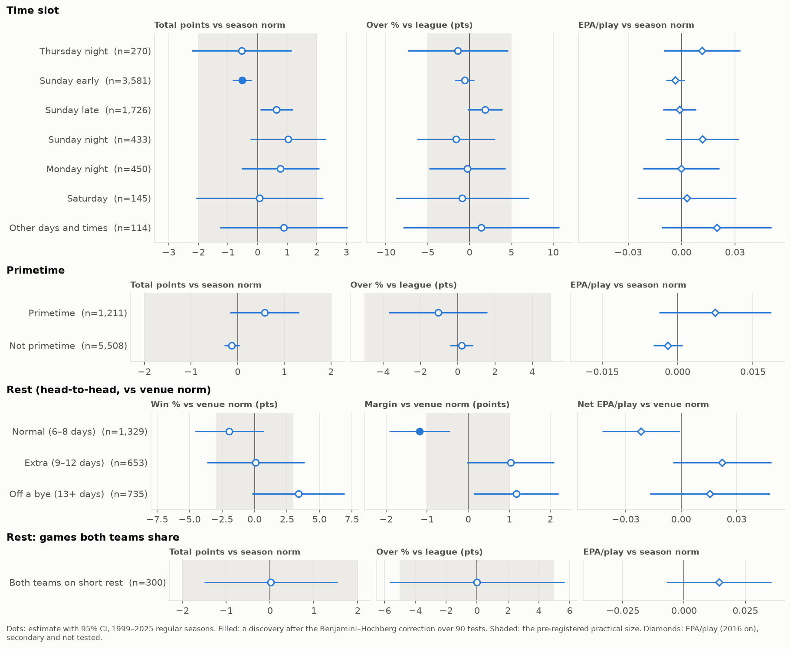
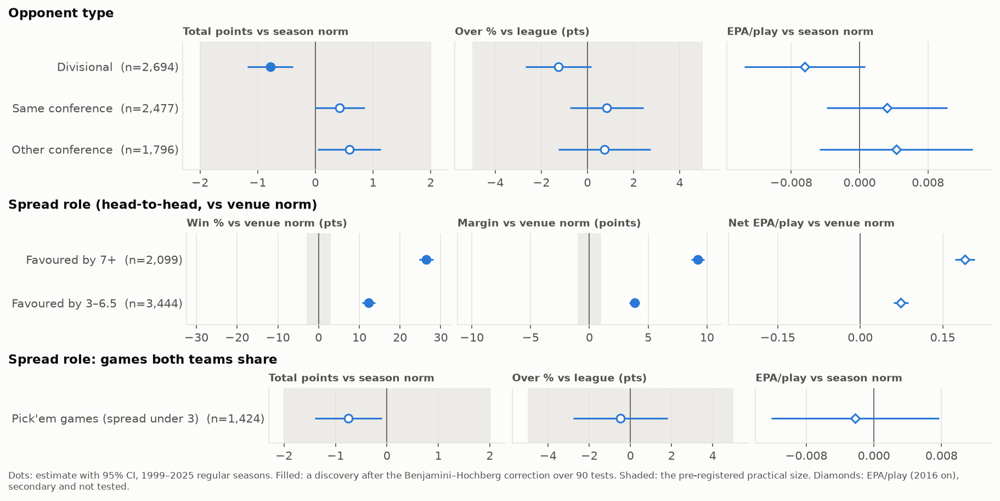
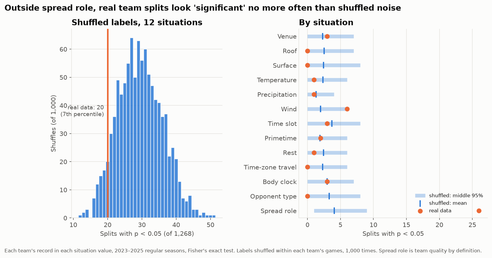
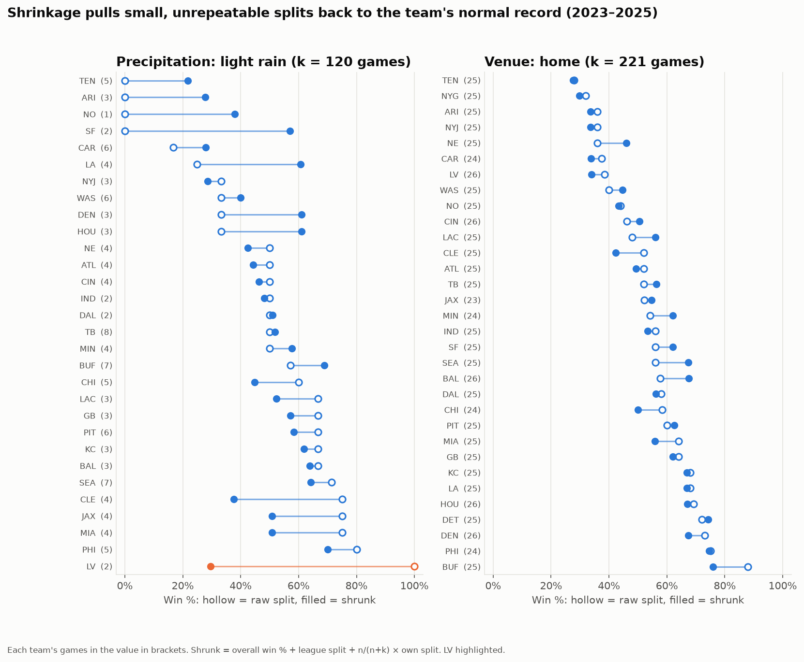
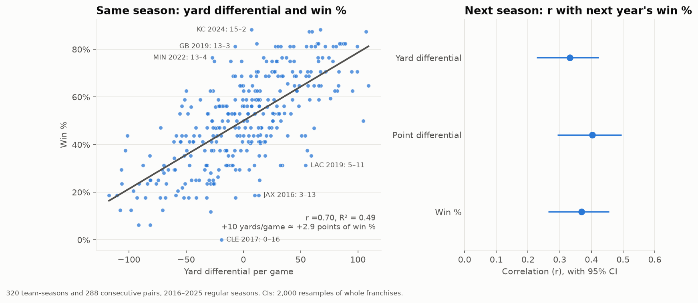
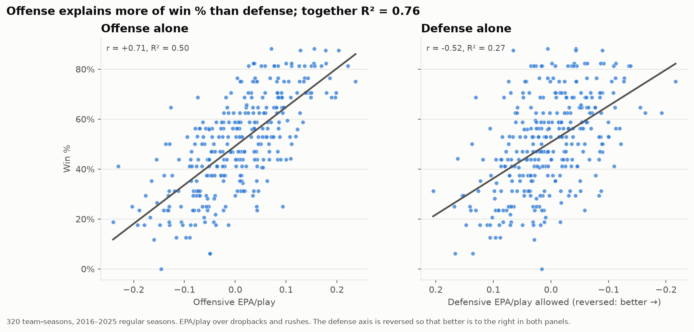

# Findings: which situations matter

**Status: decided (18 October 2026).** Rob confirmed the verdicts below, which follow the rule fixed before any result was seen. The registry now matches them (see the end of the verdicts section), and `decisions.md` records the decision.

Down & Distance's team research shows how NFL teams do in particular situations: rain, a short week, a trip across time zones. Before building pages around those situations, the analysis asked which of them actually change results. This document answers that for a reader with no statistics background. Every number comes from the notebooks in `notebooks/` (03 to 06), which re-run from the database.

## The short version

- **Weather changes scoring.** Heavy rain costs about 5 points a game and strong wind about 4. Only 37% of heavy-rain games went over the betting total (the league norm is 50%). That is partly hindsight, though: our weather is what actually happened, while the totals were set on forecasts.
- **Domes add about 3 points a game**, but the betting total already expects that.
- **Home field is worth about 2.4 points**, and home teams win 56.5% of the time. The point spread already prices it in.
- **Facing a better-rested opponent costs about a point.** That's priced in too.
- **Crossing time zones makes no measurable difference** once you allow for being the away team.
- **A team's own record in a situation is mostly luck.** The Raiders' 2–0 in light rain is best read as their usual 30%.
- **On team quality:** offense explains more of winning than defense, and points scored and allowed predict next season better than yards.

## How to read the numbers

- **n** is the number of games behind a figure. Small n means a shaky figure.
- **The range in brackets**, e.g. −5.1 [−7.0, −3.2], is a 95% confidence interval: the values the data can't rule out. If the range crosses zero, the data can't tell whether there's an effect at all.
- **Fair comparisons.** A situation is compared with what would have happened anyway:
  - teams in a situation are compared with other teams at the same venue (home, away or neutral) in the same season;
  - games in a situation are compared with the average game of that season, because scoring changes from year to year.
- **A luck check across many comparisons.** Test 90 situations at once and about 4 or 5 will look like effects by pure luck. A standard correction (Benjamini–Hochberg) keeps such false alarms to at most 1 in 20 of the effects reported as real; those are called *discoveries*.
- **Practical size.** An effect smaller than 1 point of margin, 3 points of win %, 2 points of total scoring, or 5 points of over % wouldn't change how anyone watches or bets on a game, even if it's real.
- **Rules written in advance.** These thresholds and the verdict rule were logged and pushed before any estimate was run (`decisions.md`, 17 October 2026), so the evidence couldn't be read to suit a conclusion.

The analysis covers 6,967 regular-season games from 1999 to 2025, and the 2,639 from 2016 on for play-by-play measures. Playoffs and the 2026 season in progress are left out. 2020, played in mostly empty stadiums, is left out of home/away comparisons only.

## The verdicts

The rule decides each of the 13 situations in the site's registry:
- **Feature:** at least one value is a discovery *and* of practical size.
- **Trim:** every value's range sits inside the practical size, so an effect that matters has been ruled out.
- **Keep as a filter, not featured:** the evidence is inconclusive either way.
- **Venue and spread role always stay**, as the context everything else is read against.

| Situation | Verdict | The evidence | Recommendation |
| --- | --- | --- | --- |
| Venue | Stays (context) | Home teams +2.4 points [+2.0, +2.7], win % +6.5 points | Keep: the baseline for every team split |
| Roof | **Feature** | Domes +2.8 points a game [+2.1, +3.6] | Feature, noting that betting totals already expect it |
| Surface | **Trim** | Turf +1.2, grass −0.9: real but small, and partly the dome effect | Trim |
| Temperature | Keep | 33–50°F −1.2 points: real but small; 32°F or below too uncertain | Keep as a filter; re-check as seasons accumulate |
| Precipitation | **Feature** | Heavy rain −5.1 points and over % −12.8; light rain −2.8 and −6.1 | Feature: the strongest finding |
| Wind | **Feature** | 15+ mph −3.8 points; 10–14 mph over % −5.3 | Feature |
| Time slot | Keep | Sunday early −0.5 points: real but tiny; the rare slots are too uncertain | Keep as a filter |
| Primetime | **Trim** | +0.6 points [−0.2, +1.3]; over % within ±5 | Trim (time slot already shows primetime games) |
| Rest | **Feature** | Facing a better-rested opponent −1.2 points [−1.9, −0.4] | Feature, but see the short-rest problem below |
| Time-zone travel | Keep | No effect once home field is removed; long trips too few to judge | Keep as a filter, never shown raw |
| Body clock | Keep | Morning −1.1 and night −1.7, but neither is a discovery | Keep as a filter; re-test later |
| Opponent type | **Trim** | Divisional games −0.8 points: real but small | Trim |
| Spread role | Stays (context) | Favourites by 7+ win 80%: team quality by definition | Keep: the context for cover % |

**Decision and registry changes (18 October 2026).** Rob confirmed every verdict.
- **Trimmed:** surface, primetime and opponent type now have `in_v1` set to false. Their data and columns stay in the split marts; the site just won't offer them as v1 filters.
- **Added: rest advantage**, a team-level v1 situation built from the rest difference between the teams: `less_rest` (3 or more days fewer than the opponent), `even` (within 2 days) and `more_rest` (3 or more days more). It carries the rest finding (section 5). The original rest buckets stay as a filter.
- **Featured vs filter** is a page-design choice and needs no registry change.

---

## 1. The data match the record books

**Question.** Before trusting any situation effect, do the database's basic numbers agree with published figures?

**Method.** Home teams' record and points per game for every season since 1999, compared with figures published by the Associated Press and NBC Sports.

**Result.** All nine published figures match exactly, including:
- 2020's home record of 127–128–1, the first losing home season in NFL history;
- 2020's 12,692 points, a record 24.8 per team per game.

The chart also shows that the home edge had already vanished in 2019, the year *before* empty stadiums: home teams were outscored by 0.1 points a game.

**Caveat.** Pro Football Reference, the usual source, blocks automated requests, so news reports stood in for it.

## 2. Weather: rain and wind lower scoring, and the market lags

**Question.** Do rain, wind, snow and temperature change how many points are scored? Do the betting totals already account for it?

**Method.**
- Each open-air game's total points are compared with that season's average game.
- Its result against the betting total (over or under) is compared with the league's over rate.
- Weather comes from a historical weather model for each stadium, over the three hours after kickoff.

**Result.**

| Weather | Games | Points vs a normal game | Over % vs the league |
| --- | --- | --- | --- |
| Heavy rain (0.10 in or more) | 194 | −5.1 [−7.0, −3.2] | −12.8 [−19.5, −6.1] |
| Light rain | 498 | −2.8 [−4.0, −1.6] | −6.1 [−10.3, −1.8] |
| Snow | 119 | −1.2 [−4.2, +1.8] | +1.8 [−7.5, +11.2] |
| Wind 15+ mph | 514 | −3.8 [−5.0, −2.7] | −5.0 [−9.1, −0.9] |
| Wind 10–14 mph | 1,395 | −1.9 [−2.6, −1.3] | −5.3 [−7.7, −2.9] |
| 32°F or below | 329 | −1.4 [−2.9, +0.2] | +1.9 [−3.5, +7.4] |

What the table shows:
- **Rain and wind cut scoring, and offenses are less efficient per play too.** Games in heavy rain went over the total only 37% of the time. Read that with the forecast caveat below: it doesn't by itself show that the market misjudged the weather.
- **The effects hold up in the 2016–2025 seasons on their own**, and against other open-air games rather than the whole league. For example, heavy rain is −4.2 points compared with other outdoor games, so it isn't just the dome-versus-outdoors difference.
- **Snow shows no clear effect**, but 119 games can't rule one out.
- **Cold:** a drop appears only in the recent seasons (−3.9 points over 2016–2025), so it's worth re-testing.

**Caveat.**
- **Hindsight.** Our weather is what actually happened during each game, while betting totals are set beforehand on forecasts. Rain that wasn't forecast lowers scoring after the total is set, so the low over % in rain and wind partly reflects hindsight. It isn't necessarily a market inefficiency. Testing that would need the forecasts the totals were set on; a forecast loader could keep each game's last pre-kickoff forecast for it.
- Rain and snow amounts come from a weather model on a grid roughly 10–30 km across. It smooths out local squalls: the famous 2017 Buffalo snow game shows under an inch.
- "Over %" depends on the betting totals in nflverse's schedule data, whatever time of day those lines were taken.

## 3. Roof and surface: domes score more, the market knows

**Question.** Do domes and artificial turf change scoring?

**Method.** As for weather: total points against the season's average game, and over % against the league.

**Result.**
- **Domes:** about 2.8 more points per game [+2.1, +3.6] over 1,138 games. Retractable roofs score more too, open or closed. The over % isn't significantly different (+2.2 [−0.4, +4.9]), so the betting totals already expect the extra points.
- **Surface:** turf games score 1.2 points more and grass games 0.9 fewer. Both are real but small.
  - Part of the gap is the dome effect: 1,087 of the 1,138 dome games were on turf.
  - Among outdoor games alone, turf still scores about 0.8 points more than grass, a gap well below the practical size.

**Caveat.** A stadium's roof and surface come with its home team. Some of the dome effect may be the offenses that happen to play there.

## 4. Home field: real, smaller than it was, and priced in

**Question.** How much is playing at home worth, and does the betting market account for it?

**Method.** Every non-neutral game from the home side, 2020 left out.

**Result.** Home teams win 56.5% of their games and outscore visitors by 2.4 points [+2.0, +2.7]. The edge has shrunk: 2.0 points over 2016–2025.
- **After the strength control** (each team's record in its other games that season), it's still +2.3 points. Home field isn't just good teams playing at home.
- **Against the spread** it's +0.1 [−0.2, +0.4]: the market prices it fully.

**Caveat.** This is the league's average home edge. Some teams' edges really are larger than others' (see finding 9), though the differences are small.

## 5. Rest: a better-rested opponent costs about a point

**Question.** Do days of rest matter?

**Method.** Only games where the two teams had *different* rest, compared with the venue norm. When both teams have the same rest, the comparison can't tell anything: one wins and one loses.

**Result.**
- **Facing a better-rested opponent:** teams on normal rest facing an opponent off a bye or extra days did 1.2 points worse than usual [−1.9, −0.4], over 1,329 games. This is a discovery, and of practical size.
- **Coming off a bye:** teams did 1.2 points better [+0.1, +2.2], over 735 games. It's real in its own range but doesn't survive the luck check.
- **Both adjustments:** both effects survive the strength control but disappear against the spread. They're real, and the market prices them in.

**Caveat: the short-rest bucket doesn't work as defined.** In 300 of the 309 short-rest games, *both* teams were on short rest; these are Thursday games. A team's "short rest" record therefore says nothing about rest. Measured as games, they score normally (+0.0 points [−1.5, +1.5]).

**What changed.** The useful measure is the rest *difference* between the teams, so **rest advantage** was added to v1: 3 or more days fewer than the opponent, within 2 days, or 3 or more days more (1,320 / 11,294 / 1,320 team-games, 1999–2025). On the plain league split, teams with 3 or more days less rest win 48.4% and lose by 1.0 point a game on average. That split isn't venue-adjusted; the head-to-head estimate above is the careful one.

## 6. Travel and body clock: being away is the effect, not the trip

**Question.** Does crossing time zones, or kicking off at an odd hour on the team's home clock, hurt?

**Method.** Only games where the two teams differed (for example, one team crossed time zones and the other didn't), compared with teams at the same venue.

**Result.**
- **Travel shows no effect.** Eastbound teams: +0.1 points [−0.4, +0.6]. Westbound teams: −0.5 [−1.0, +0.1]. The site's raw numbers would mislead here: eastbound teams win only 44% of the time, but every away team wins about 43.5%. That's being away, not the trip.
- **Body clock is a maybe.** Two values look negative:
  - teams playing before noon by their own clock did 1.1 points worse [−2.1, −0.0], over 684 games. 98% of them are teams from the Pacific and Mountain time zones playing early games in the East;
  - teams playing at 7 pm or later by their own clock, while the opponent's clock read earlier, did 1.7 points worse [−3.3, −0.1], over 292 games.

  Both survive the strength control and the spread, which would read as real and under-priced. But neither survives the luck check, and the morning effect *reverses* over 2016–2025 (+0.4).
- **Long trips (4+ time zones, mostly games in Europe):** only 49 games, too few to judge either way.

**Caveat.** Body clock and travel overlap heavily (a Pacific team at an early Eastern kickoff is both), so they can't be fully separated.

## 7. Schedule and opponent: small or nothing

**Question.** Do time slot, primetime or the type of opponent change scoring?

**Result.**
- **Time slot and primetime:**
  - Sunday early games score 0.5 points below average and Sunday late games 0.6 above. Both are real but tiny.
  - Primetime games are within a point of normal: +0.6 [−0.2, +1.3].
  - The rare slots (Saturday, 145 games; other days, 114) are too uncertain to say anything.
- **Opponent type:** divisional games score 0.8 points fewer [−1.2, −0.4]. That's real but below the practical size, and the over % is normal.

**Caveat.** Primetime games are chosen for their matchups. Total points mix the slot with the teams playing in it; over % compares with a betting total that already prices the teams, so it's the fairer test of the slot itself.

## 8. Reading each team effect with both adjustments

A raw effect can come from *who* is in the situation rather than the situation itself. Two adjustments separate them:
- **Strength control:** compare each team with its own record in its other games that season.
- **Against the spread:** compare it with the market's forecast.

How to read the result:
- An effect that **disappears under the strength control** is team composition: who tends to be in the bucket.
- One that **survives strength but not the spread** is real and priced in by the market.
- One that **survives both** is real and under-priced.

| Team situation | Games | Raw margin | After strength | Against the spread | Reading |
| --- | --- | --- | --- | --- | --- |
| Home | 6,648 | +2.4 | +2.3 | +0.1 | Real, priced in |
| Facing a better-rested opponent | 1,329 | −1.2 | −0.9 | −0.5 | Real, priced in |
| Off a bye | 735 | +1.2 | +1.3 | +0.5 | Real, priced in (didn't survive the luck check) |
| Morning body clock | 684 | −1.1 | −1.1 | −1.0 | Reads real and under-priced, but didn't survive the luck check and reverses in 2016–2025 |
| Night body clock | 292 | −1.7 | −2.0 | −1.6 | Reads real and under-priced, but didn't survive the luck check |
| Time-zone travel (east, west, none), extra rest, afternoon and late-afternoon body clock | | within ±1 | | | No raw effect to explain |
| Spread role | | | | | Not classified: the spread is set from team strength, so the strength control is circular |

One more caution: the market may also price the situation itself. So "disappears against the spread" means the betting line already contains it, whatever the reason.

## 9. A team's own splits are mostly luck

**Question.** The site will show records like "Raiders, 2–0 in light rain". How much does a split like that mean?

**Method.** Four checks, on every team's record in every situation value over the site's default three seasons (2023–2025):
- **Chance:** how often a team's record produces the split by luck alone.
- **The shuffle test:** shuffle the situation labels among each team's games 1,000 times, and see how many splits look "significant" by chance.
- **Persistence:** does a team's split in 2015–2019 repeat in 2021–2025?
- **Shrinkage:** how far should a small-sample split be pulled back to the team's normal record?

**Result.** The Raiders went 2–0 in light rain while winning 15 of 51 games (29%). That record says almost nothing:
- **Luck explains it.** Two random games from that stretch would both be wins 8% of the time. Across all 90 two-game splits the site would show, luck predicts 20 records of 2–0, and there are exactly 20.
- **Few splits are real.** Of 1,419 team splits, 20 look "significant" outside spread role, against 29.5 on average when the labels are shuffled. That's no more than noise, at the low end of its normal range. None survive the luck check.
- **Splits barely repeat.** A team's own split in 2015–2019 correlates only 0.11 with the same split in 2021–2025. Home vs away is the one split that clearly repeats: some teams really do have bigger home edges.
- **Shrunk, it's their normal record.** Even the most repeatable situations need about 120 games before a team's own split earns half the weight. The best estimate of the Raiders' light-rain win % is 30%, not 100%.

**Caveat.** The tests treat a team's games as interchangeable, ignoring who the opponent was. Ten seasons can show that team-specific effects are small, but can't rule out small ones.

## 10. What wins: yards, points, offense and defense

**Question.** Does out-gaining opponents in yards predict winning? Is offense or defense more important? Which carries over to the next season?

**Method.** All 320 team-seasons from 2016 to 2025, using straight-line fits and correlations. The ranges come from resampling whole franchises.

**Result.**
- **Yards:** yard differential explains about half of a team's win % in the same season (r = 0.70). Each extra 10 yards a game goes with about half a win over 17 games. As a predictor of *next* season it's weaker than point differential (0.33 against 0.40).
- **Offense vs defense:** offense explains 50% of win %, defense 27%; the gap is 11 to 35 points. A unit of efficiency is worth the same on either side, but teams differ more on offense. Together they explain 76%.
- **Carry-over:** offense carries over from one season to the next a little more than defense (0.39 against 0.26), but ten seasons can't tell those apart. Neither carries over much.

**Caveat.** One team's offense faces another's defense, so team-seasons aren't fully independent. Correlation isn't cause either: a team that leads late runs the ball and gives up yards.

## A caveat on EPA

EPA (expected points added) measures plays against an expected-points model. That model already allows for home field, the roof and the era. So EPA shows almost nothing for venue and roof: home teams' net EPA per play is +0.001 while they win by 2 points a game. It does show weather, which the model doesn't include. The site should explain this wherever it shows EPA by situation.

## What this means for the site

The first follows from the verdicts and the third was done in this analysis; the others are ideas for later, recorded in `parking-lot.md` rather than in the code.

1. **Feature the weather.** Rain and wind are the clearest effects. Over % in rain and wind is worth showing, with the hindsight caveat: it describes games played in that weather, not games forecast to have it.
2. **Show team situations against the venue norm, not raw.** A raw "eastbound teams win 44%" blames travel for what is simply being away.
3. **Lead with rest advantage, not short rest.** The short-rest bucket almost always contains both teams. Rest advantage, added in this analysis, is the measure that carries the effect.
4. **Show team splits with their noise.** A shrunk estimate or the number of games beside every record, and leaderboards with a real minimum.
5. **Explain EPA's built-in adjustments** on the methodology page.

## Limits of this analysis

- **Observational data.** The analysis shows what goes with what, not what causes what.
- **Regular season only, 1999–2025.** Play-by-play measures cover 2016–2025 only.
- **Ranges can be optimistic.** They treat games or team-seasons as independent, which is mostly but not entirely true.
- **Small situations stay uncertain.** Snow, long trips and the rare time slots have too few games to settle.
